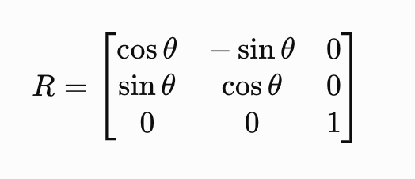
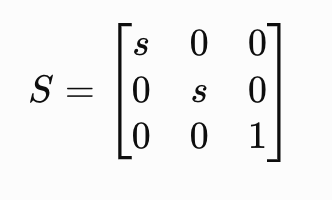

#Mini miner
The game will have a stationary miner at the top, while gold, rocks, diamonds, and bombs automatically travel upward from the bottom. The player uses mining tools to destroy or collect objects before they reach the miner.

## Gameplay rules

```python
Element	            Behaviour
Miner	        Stays at the top
Gold	        Moves upward; collect with mining tool
Diamond	        Moves upward; collect with mining tool
Rock	        Requires multiple hits to break
Bomb	        Moves upward; damages miner if it reaches the danger zone
Pickaxe	        Attacks nearby objects
Hammer	        Deals more damage to rocks
Health	        Decreases when bombs reach the miner
Score	        Increases when minerals are collected
```

How we will use matrices
We will use 3×3 matrices for all 2D transformations.

```python

  Matrix	                        Application in your game
Translation	                    Move gold, rocks, diamonds and bombs upward
Rotation	                    Rotate diamonds, bombs and pickaxes
Scaling	                        Animate rock damage and bomb explosions
Combined transformation	        Position, rotate and scale objects together

```

For example, when a gold object moves upward:
[!H]

Here, \(v\) is the object's upward movement speed.

When a diamond rotates:


When a rock breaks:


We will combine these matrices into one transformation:

M=T* R * S

This is the mathematical foundation of our JavaScript game engine.

# Project architecture

MinerGame/
│
├── app.py
│
├── templates/
│ └── index.html
│
├── static/
│ ├── css/
│ │ └── style.css
│ │
│ └── js/
│ ├── matrix.js
│ └── game.js
│
└── requirements.txt

The responsibilities will be:

- matrix.js: matrix calculations and transformations.
- game.js: spawning, movement, mining, collision detection and animations.
- index.html: game interface and controls.
- style.css: game appearance.
- app.py: Flask API, inventory and score management.

# Implement the matrix engine

Create static/js/matrix.js.

This is the mathematical engine that all our game objects will use.

class Matrix2D {

    // Identity matrix
    static identity() {
        return [
            [1, 0, 0],
            [0, 1, 0],
            [0, 0, 1]
        ];
    }

    // Translation matrix
    static translation(x, y) {
        return [
            [1, 0, x],
            [0, 1, y],
            [0, 0, 1]
        ];
    }

    // Rotation matrix
    static rotation(angle) {
        const c = Math.cos(angle);
        const s = Math.sin(angle);

        return [
            [c, -s, 0],
            [s, c, 0],
            [0, 0, 1]
        ];
    }

    // Scaling matrix
    static scaling(sx, sy) {
        return [
            [sx, 0, 0],
            [0, sy, 0],
            [0, 0, 1]
        ];
    }

    // Matrix multiplication
    static multiply(A, B) {
        const result = this.identity();

        for (let i = 0; i < 3; i++) {
            for (let j = 0; j < 3; j++) {
                result[i][j] = 0;

                for (let k = 0; k < 3; k++) {
                    result[i][j] += A[i][k] * B[k][j];
                }
            }
        }

        return result;
    }

    // Apply matrix to a point
    static transformPoint(matrix, x, y) {
        return {
            x: matrix[0][0] * x +
               matrix[0][1] * y +
               matrix[0][2],

            y: matrix[1][0] * x +
               matrix[1][1] * y +
               matrix[1][2]
        };
    }

    // Apply matrix to HTML Canvas
    static applyToCanvas(ctx, matrix) {
        ctx.setTransform(
            matrix[0][0],
            matrix[1][0],
            matrix[0][1],
            matrix[1][1],
            matrix[0][2],
            matrix[1][2]
        );
    }

    // Combine transformations
    static compose(x, y, angle, sx, sy) {

        const T = this.translation(x, y);
        const R = this.rotation(angle);
        const S = this.scaling(sx, sy);

        return this.multiply(
            this.multiply(T, R),
            S
        );
    }

}
